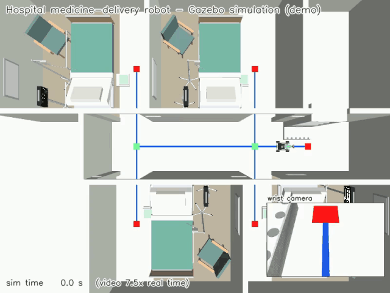
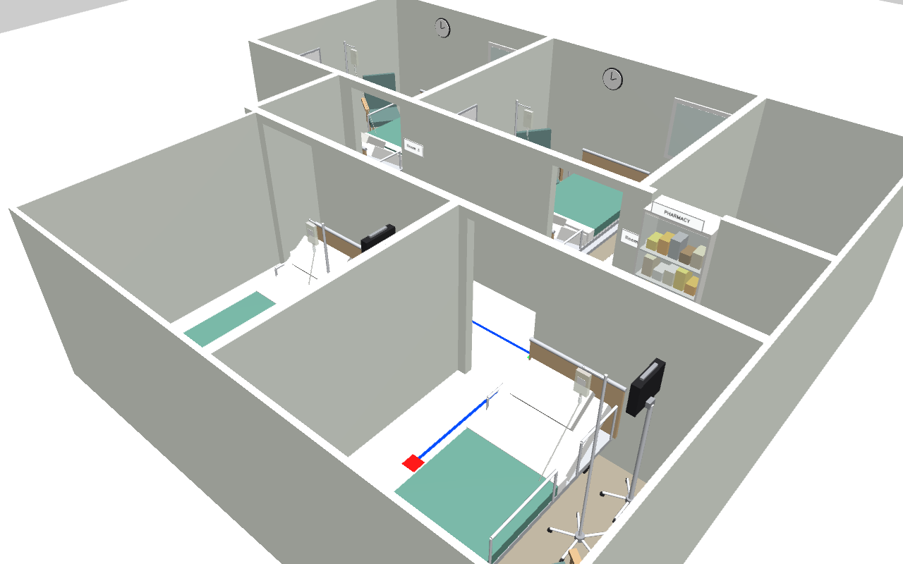
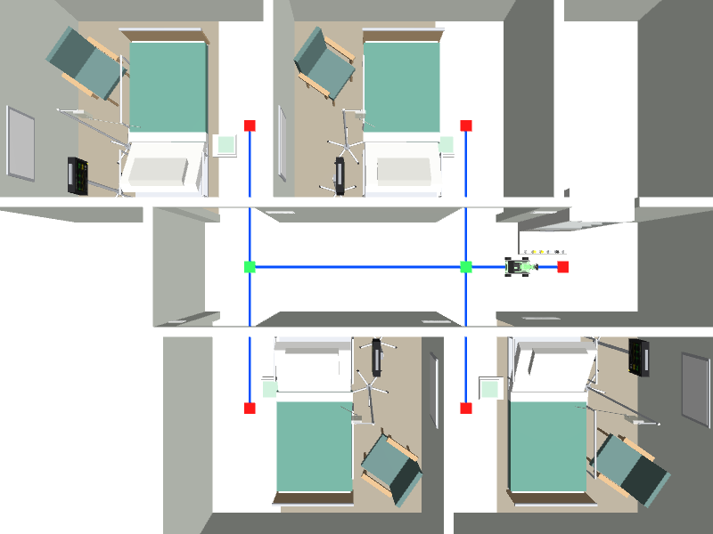
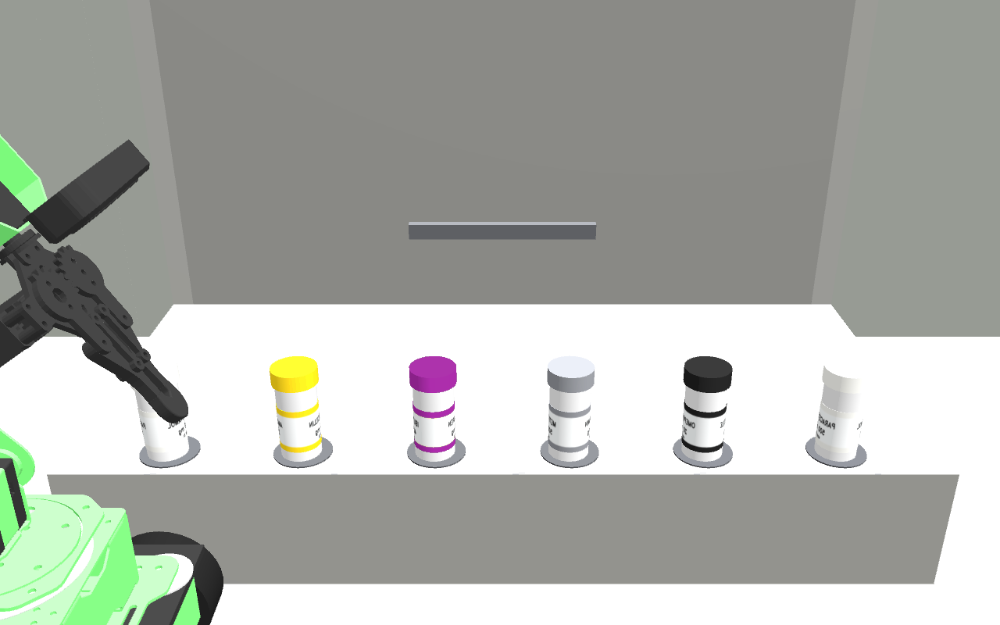
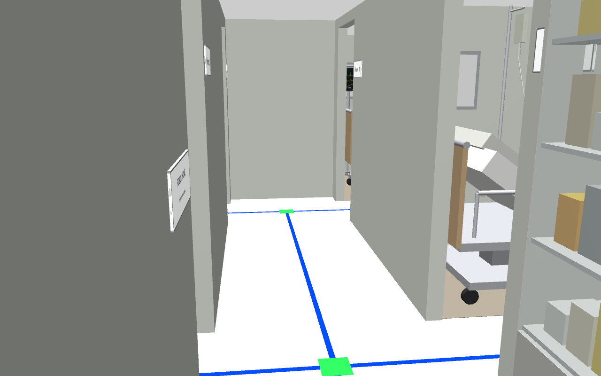
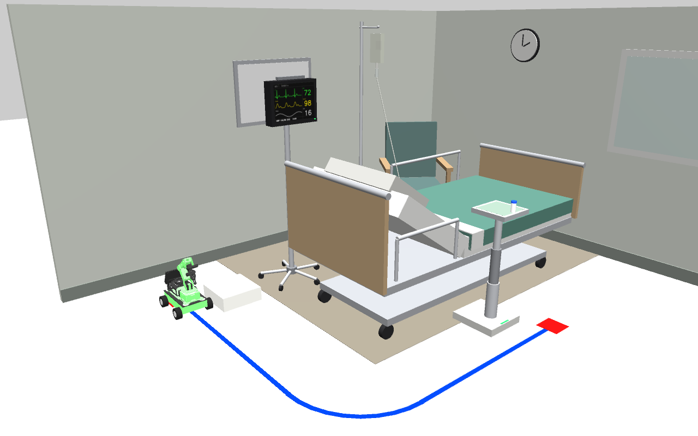
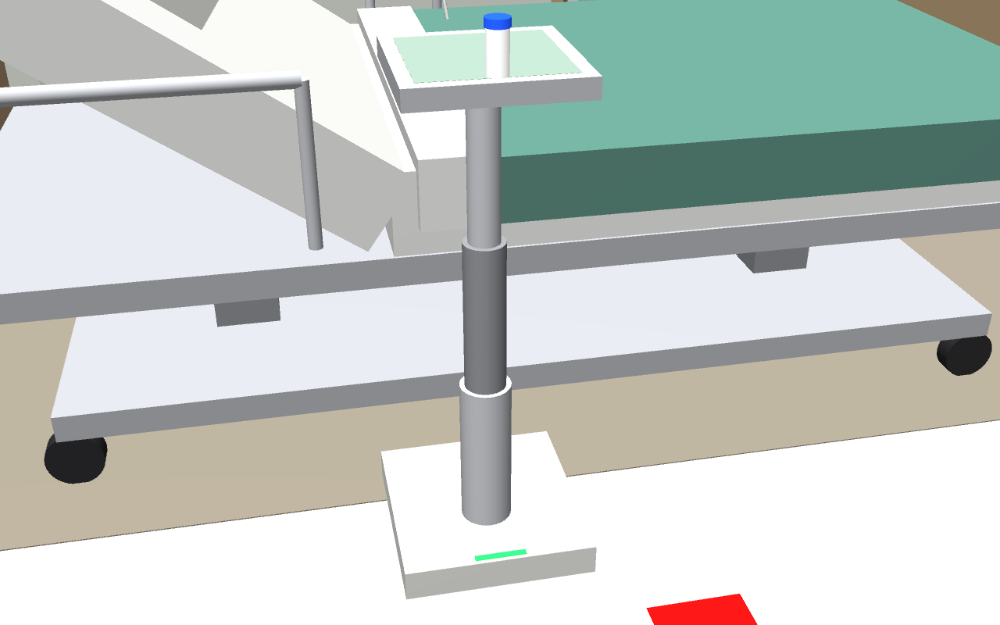
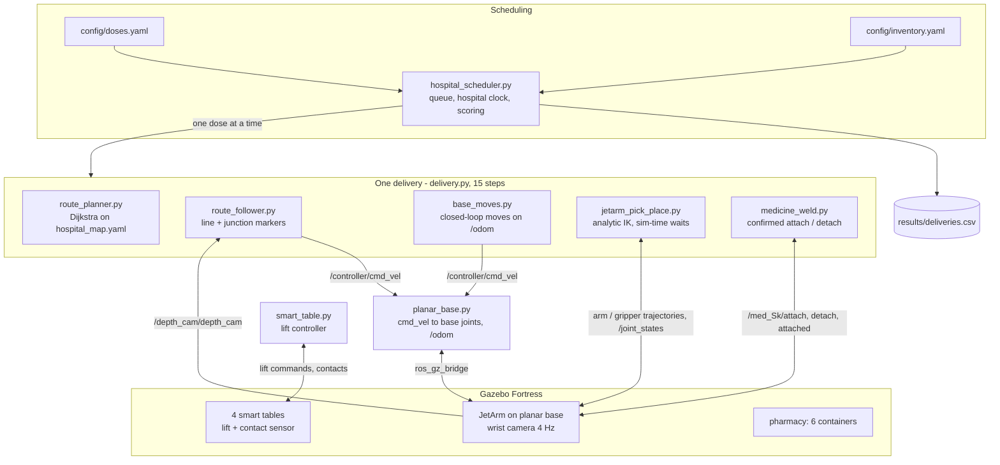

# TrackMed - An Autonomous Mobile Manipulator for Scheduled Medication Delivery in Hospitals

[](https://github.com/Seif-Taha12903478/sdp_sim/actions/workflows/offline-tests.yml)

TrackMed is a mobile manipulator: a Hiwonder JetArm Pro 5-DOF arm on a mecanum chassis
with a wrist camera. It delivers medication on a schedule, without a human in the loop.
At each due time it:
1. drives to the hospital pharmacy and picks the right medicine container from a
   6-slot counter, checking the cap colour first;
2. follows a taped line network through a corridor with junctions to the patient's room,
   and places the container on a smart bedside table;
3. drives home while the table lifts the medicine to bed height for the patient.

Several patients and rooms are handled by a scheduler:
- doses are queued by due time, then by distance;
- lateness is logged;
- every delivery is scored automatically from ground truth.

The whole system runs in ROS 2 Humble + Gazebo Fortress. That simulation is the final
deliverable, because the physical robot was not usable for the final evaluation.

**Course:** Senior Design Project - American University of Ras Al Khaimah, Department of
Computer Science and Engineering, Fall 2026. **Supervisor:** Dr. Arfan Ghani.

**Team:** Seif Elwalid Elsenousy Taha, Mohammed Yousef Ahmed Hajeeh Alblooshi, Salem Alnuaimi,
Yousef Abdulla Yousef Abdulla Bin Salman.

## Demo



*Preview of the final demo, ~50x simulated time: four scheduled deliveries (Rooms 1, 3, 4, 2)
on a hospital clock starting at 08:00.*

Full videos:
- [media/system_demo.mp4](media/system_demo.mp4): hospital system, 4/4 deliveries,
  113.8 s at 7.5x simulated time.
- [media/mission_room.mp4](media/mission_room.mp4): single patient room with the smart
  table lifting the medicine, 25.5 s.

| | | |
|---|---|---|
|  |  |  |
| The hospital: corridor, pharmacy, four patient rooms | Top view: blue line, green junction markers, red stop markers | Pharmacy counter: six labelled containers, cap colours per medicine |
|  |  |  |
| Down the corridor: junction J1 | Patient room, smart table raised after a delivery | The medicine lifted to bed height (0.80 m) |

## Features
- **Scheduled delivery**:
  - daily dose times per patient in `config/doses.yaml` (real time, Asia/Dubai);
  - a demo mode on a simulated hospital clock;
  - queueing by due time, then route length; lateness logging;
  - out-of-stock handling (`config/inventory.yaml`, 6 slots).
- **Line-network navigation**:
  - Dijkstra route planning on the map graph;
  - camera-based line following with PD steering;
  - green junction markers (straight / left / right) and red stop markers;
  - every marker is checked against the plan (colour, order, odometry window); a
    mismatch stops the robot with an error.
- **Pick and place**:
  - analytic IK for the 5-DOF arm;
  - line-up with the slot on odometry to 0.5 mm;
  - the cap colour is checked with the wrist camera before the pick;
  - a confirmed weld-assisted grasp (attach/detach acknowledged, retried).
- **Smart bedside table**:
  - a contact sensor detects the container;
  - it lifts the medicine 0.10 -> 0.80 m in 18.6 s, once the robot has released it and
    the arm is clear;
  - it lowers again when the medicine is taken.
- **Self-checking**:
  - every step waits on simulated feedback (never on wall-clock time);
  - physical checks from Gazebo ground truth;
  - automatic scoring: the right container on the right raised platform, all others
    untouched.
- **Reproducible worlds**: every number of the layout is in one file
  (`tools/system_layout.py`). The generators check clearances and colours, and CI checks
  the committed worlds match them.

## System architecture


Details: [docs/ARCHITECTURE.md](docs/ARCHITECTURE.md).

## Key results

| test | runs | result | placement error | details |
|---|---|---|---|---|
| Single room, 5-run evaluation (fresh launch per run, confirmed weld) | 5 | **5/5 success** | 0.19 mm mean (max 0.20), tilt 0.0 deg | [results/eval_5runs_confirmed/summary.txt](results/eval_5runs_confirmed/summary.txt) |
| Patient room with the smart table (scheduled missions) | 2 | **2/2 success**, table raised to 0.80 m | 0.27 mm, 0.25 mm | [results/room_mission/](results/room_mission/) |
| Hospital system, one delivery (Room 3) | 1 | **success** | 2.8 mm | [results/system/delivery_room3_20261110_185826/](results/system/delivery_room3_20261110_185826/) |
| **Hospital demo**: 4 scheduled deliveries, Rooms 1/3/4/2 | 4 | **4/4 success**, right container on the right raised table, others untouched (<= 0.14 mm) | 2.0 / 1.4 / 0.6 / 1.7 mm | [results/system/demo_20261111_131344/summary.txt](results/system/demo_20261111_131344/summary.txt) |
| Offline route simulation (synthetic camera) | 109 checks | **109/109** (51 delivery legs incl. start offsets, fast mode, 3 fault cases) | stops within 16 mm | `tools/offline_route_sim.py` |

Success criterion (single room): mission completed, container on the table within 30 mm
of the target, and tilt < 10 deg.

Earlier history: the first 5-run evaluation scored 2/5 with one-shot attach/detach
commands, which got lost. Confirmed, retried commands fixed that.

Every test, how to reproduce it and its result files: [docs/TESTING.md](docs/TESTING.md).

## Limitations
- **Simulation only.** The chassis dimensions are estimates from Hiwonder's photos.
- **Simplified base and grasp.**
  - The base is a planar joint chain, not wheel/floor physics; the wheels are visual.
  - The grasp is weld-assisted: the fingers close, then a DetachableJoint carries the
    container. A friction grasp made the simulation ~30x slower.
- **Navigation only on the taped line network.**
  - No obstacle detection or avoidance, no people, no doors.
  - The tape colours and thresholds are tuned to this world's lighting.
- **One container per trip, one robot.** Later doses wait: up to 7 min late in the demo.
- **The cap colour is the only identity check** before a pick (no barcode or label reading).
- **Slow on small machines.** On the 2-core VM the real-time factor is ~8-10 %: one
  delivery takes 60-100 min and the 4-delivery demo 5.7 h. For the same reason the full
  hospital demo was run once successfully (attempt 1 stopped after 2/3), not 5 times.
- **Open issues:**
  - systematic placement offset of 0.5-2 mm;
  - the scheduler exits with code -6 inside rclpy shutdown after finishing (harmless);
  - the cause of one frozen joint-state cache (demo attempt 1) is unknown; it is now
    detected and recovered.
- **Install path is fixed.** The repo must be cloned to `~/sdp_sim`: the launch files
  start the helper scripts from there.

## Requirements
- Ubuntu 22.04 (tested in a VMware VM, 2 cores; more cores = faster simulation)
- ROS 2 Humble, Gazebo Fortress (`ign gazebo` 6.x) with `ros_gz`, `ign_ros2_control`,
  `ros2_controllers`
- Python 3.10 with OpenCV, NumPy, PyYAML, Matplotlib (all from apt)
- The Hiwonder JetArm ROS 2 simulation packages (see step 3)

## Installation (clean Ubuntu 22.04)

1. **ROS 2 Humble** (official instructions:
   [docs.ros.org](https://docs.ros.org/en/humble/Installation/Ubuntu-Install-Debs.html)):
   ```bash
   sudo apt update && sudo apt install -y software-properties-common curl
   sudo add-apt-repository -y universe
   sudo curl -sSL https://raw.githubusercontent.com/ros/rosdistro/master/ros.key -o /usr/share/keyrings/ros-archive-keyring.gpg
   echo "deb [arch=$(dpkg --print-architecture) signed-by=/usr/share/keyrings/ros-archive-keyring.gpg] http://packages.ros.org/ros2/ubuntu jammy main" | sudo tee /etc/apt/sources.list.d/ros2.list
   sudo apt update && sudo apt install -y ros-humble-desktop python3-colcon-common-extensions
   ```
2. **Gazebo Fortress, bridges, controllers and Python libraries** (`ros-humble-ros-gz`
   brings Gazebo Fortress on Humble):
   ```bash
   sudo apt install -y ros-humble-ros-gz ros-humble-ros-ign ros-humble-ign-ros2-control \
       ros-humble-ros2-controllers ros-humble-xacro ros-humble-robot-state-publisher \
       python3-opencv python3-numpy python3-yaml python3-matplotlib unzip
   ```
3. **Hiwonder JetArm packages** (`jetarm_6dof_description`, `robot_gazebo`,
   `robot_moveit_config`). They are **not included** in this repository: their package
   files declare no licence, so we do not redistribute them.
   - Get `simulations.zip` from Hiwonder's JetArm documentation, chapter
     [ROS2-URDF Modeling Simulation](https://docs.hiwonder.com/projects/JetArm/en/jetarm-orin-nano/docs/16.ROS2_URDF_Modeling_Simulation.html),
     or from the JetArm ROS 2 virtual machine / course material that Hiwonder ships with
     the robot.
   - Extract it so that `~/ros2_ws/src/simulations/jetarm_6dof_description` and
     `~/ros2_ws/src/simulations/robot_gazebo` exist:
     ```bash
     mkdir -p ~/ros2_ws/src && cd ~/ros2_ws/src && unzip /path/to/simulations.zip
     ```
   - We used the version dated 2024-12-10 (VM image "App_ROS2_1.0 2024-12-12"). Our files
     are installed next to Hiwonder's under new names; no Hiwonder file is changed.
4. **This repository** - it must be at `~/sdp_sim`:
   ```bash
   git clone https://github.com/Seif-Taha12903478/sdp_sim.git ~/sdp_sim
   ```
5. **Environment** (the Hiwonder xacro reads `CAMERA_TYPE`):
   ```bash
   echo 'source /opt/ros/humble/setup.bash'          >> ~/.bashrc
   echo 'source ~/ros2_ws/install/setup.bash'        >> ~/.bashrc
   echo 'export CAMERA_TYPE=GEMINI'                  >> ~/.bashrc
   source /opt/ros/humble/setup.bash && export CAMERA_TYPE=GEMINI
   ```
6. **Install and build**:
   ```bash
   bash ~/sdp_sim/install.sh
   ```
   `install.sh` copies our launch files, robot xacro and worlds into Hiwonder's
   `robot_gazebo` package and builds `jetarm_6dof_description` and `robot_gazebo`. It
   also lists the Gazebo plugins it found and, if the repo is not at
   `/home/ubuntu/sdp_sim`, regenerates the worlds for your path.
7. Open a **new terminal** (so `~/.bashrc` is loaded) and continue with the quick start.

## Quick start

Only one simulation at a time: `pgrep -af "ign gazebo"` must print nothing before a
launch. Every Gazebo command below runs for minutes to hours on a small machine (see
[docs/TROUBLESHOOTING.md](docs/TROUBLESHOOTING.md)).

**Single-room mission** (pick at the station, line to the bed, place, table lifts, return):
```bash
ros2 launch robot_gazebo hospital.launch.py gui:=false     # terminal 1; omit gui:=false for the window
python3 ~/sdp_sim/scripts/jetarm_pick_place.py home         # terminal 2: arm to its ready pose
python3 ~/sdp_sim/scripts/mission.py                        # ~3 sim min, ~50 min on a 2-core VM
```

**Hospital system** (scheduler, pharmacy, 4 rooms):
```bash
ros2 launch robot_gazebo hospital_system.launch.py gui:=false     # terminal 1
python3 ~/sdp_sim/scripts/jetarm_pick_place.py home                # terminal 2
python3 ~/sdp_sim/scripts/hospital_scheduler.py --list             # today's doses and their order
python3 ~/sdp_sim/scripts/hospital_scheduler.py --now 3            # one delivery to Room 3 now
python3 ~/sdp_sim/scripts/hospital_scheduler.py                    # real schedule, runs forever
```

**The demo** (self-contained: launch, video, 4 scheduled deliveries, shutdown, summary;
~5-6 h on the 2-core VM):
```bash
bash ~/sdp_sim/tools/run_demo.sh
tail -f ~/sdp_sim/results/system/demo_<date>/scheduler.log
```

**Edit the schedule or the inventory:**
- `config/doses.yaml`: patient, room 1-4, medicine, dose, daily times.
- `config/inventory.yaml`: slot S1-S6, medicine, dose, cap colour, quantity 0/1.

See [docs/USER_GUIDE.md](docs/USER_GUIDE.md), which also covers adding a room.

**Run the tests:**
```bash
cd ~/sdp_sim
source /opt/ros/humble/setup.bash
bash tools/run_offline_tests.sh       # all offline tests, no Gazebo, ~3 min
```
The script needs only ROS 2 Humble and the Python packages from installation step 2, not
the Hiwonder packages or Gazebo. It ends with `ALL OFFLINE TESTS PASSED`. The same script
runs in GitHub Actions on every push. The Gazebo tests (route, pick, single delivery,
5-run evaluation, demo) are listed with their commands in
[docs/TESTING.md](docs/TESTING.md).

## Repository structure
```
README.md, LICENSE, install.sh       entry point, licence, installer
schedule.yaml                        single-room schedule (scripts/scheduler.py)
config/                              hospital system: doses.yaml, inventory.yaml, hospital_map.yaml (generated)
scripts/                             ROS 2 nodes and the mission code
  hospital_scheduler.py, delivery.py, pharmacy.py      hospital system
  route_planner.py, route_follower.py, line_follower.py, base_moves.py, planar_base.py
  jetarm_pick_place.py, medicine_weld.py, smart_table.py
  mission.py, scheduler.py, medicine_container.sdf     single room
robot_gazebo/                        our files for Hiwonder's robot_gazebo package (installed by install.sh)
  launch/                            hospital.launch.py, hospital_system.launch.py
  urdf/                              jetarm_mecanum(.system).gazebo.xacro - arm on the planar base
  worlds/                            generated worlds, textures, container models (do not edit by hand)
tools/                               world generators, tests, evaluation, video, demo runner
  system_layout.py, make_system_world.py, make_hospital_world.py
  run_offline_tests.sh, test_*.py, offline_route_sim.py, evaluate.py, rescore.py, scoring.py
  run_demo.sh/.py, run_in_sim.py, record_video.py, sim_screenshot.py, measure_rtf.py
docs/                                ARCHITECTURE, TESTING, USER_GUIDE, TROUBLESHOOTING
media/                               videos, GIF preview, screenshots
results/                             committed result files cited in docs/TESTING.md
.github/workflows/offline-tests.yml  CI
CLAUDE.md                            development log / notes for the AI assistant
```

## Branches
- `main` - the final version (hospital system + single room). Tagged `v1.0`.
- `hospital-room` - the single-room stage with the smart table (merged into `main`;
  kept for reference).
- `hospital-system` - development branch of the hospital system (merged into `main`;
  kept for reference).

The single-room-only state is commit `bedafd6`. The state of the 5/5 evaluation, before
the smart table, is commit `b60e882`.

## Licence
MIT for the team's own code, worlds, media and documentation - see [LICENSE](LICENSE).
Hiwonder's packages are not part of this repository. Files derived from them
(`robot_gazebo/urdf/*.xacro`, `robot_gazebo/launch/*.py`) keep Hiwonder's terms for the
Hiwonder-derived parts.

Developed with AI assistance (Claude) for code and documentation; all design decisions, testing and results were reviewed by the team.
