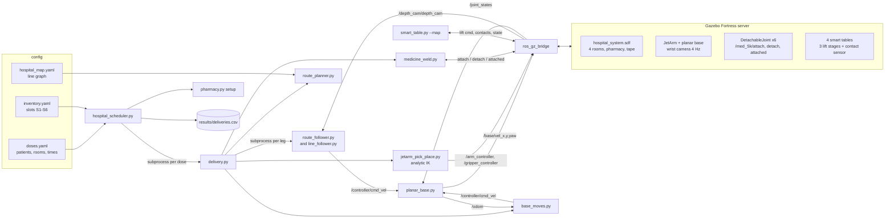
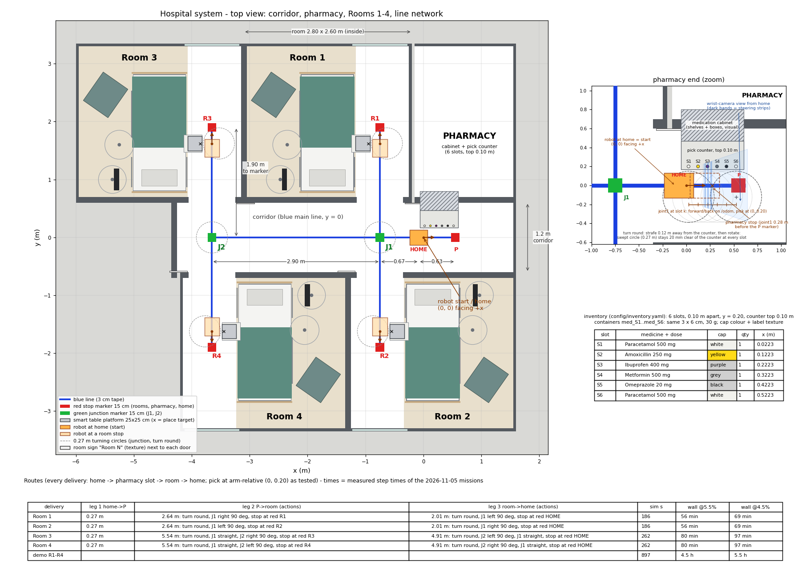

# TrackMed - architecture

TrackMed runs entirely in simulation: ROS 2 Humble + Gazebo Fortress (`ign gazebo` 6.16) on
Ubuntu 22.04. The physical robot (Hiwonder JetArm Pro on a mecanum chassis) was not usable
for the final evaluation, so the Gazebo model is the deliverable. Everything the robot does
is closed-loop on simulated feedback (joint states, odometry, camera images, contact
sensors), never on wall-clock sleeps: on the 2-core development VM, 1 simulated second
takes 10-20 real seconds.

There are two worlds:

| world | launch | purpose |
|---|---|---|
| single patient room | `ros2 launch robot_gazebo hospital.launch.py` | one line from the medicine station to one bed with a smart table; the 5-run evaluation and the patient-room missions |
| hospital system | `ros2 launch robot_gazebo hospital_system.launch.py` | corridor, pharmacy with 6 medicine slots, 4 patient rooms, 2 junctions, scheduler; the final demo |

## Processes and data flow (hospital system)

## Components

### Robot model (`robot_gazebo/urdf/jetarm_mecanum.gazebo.xacro`)
- Hiwonder's JetArm 5-DOF arm + gripper macros (from the Hiwonder packages, not in this
  repo) mounted 0.10 m above the floor on an estimated 0.32 x 0.26 m chassis.
- **Planar base**: the chassis is attached to the world by prismatic X -> prismatic Y ->
  continuous yaw joints, each driven by a Gazebo JointController in velocity mode
  (`/base/vel_x|y|yaw`). `scripts/planar_base.py` turns `/controller/cmd_vel` (robot
  frame, like the real mecanum base: linear.x, linear.y, angular.z) into those world-frame
  joint velocities and publishes `/odom` from the joint positions. It holds the last
  command until a new one arrives (no watchdog). Why: Gazebo's
  VelocityControl drifted the model upward ~1 mm per sim second, and floor friction ate
  most of the commanded speed at the 0.02 s step. The wheels are visual only.
- Arm and gripper: ign_ros2_control with JointTrajectoryControllers
  (`/arm_controller/joint_trajectory`, `/gripper_controller/joint_trajectory`) and the
  joint_state_broadcaster. Joint positions are read from `/joint_states`.
- Wrist camera on link4, 320 x 200 at 4 Hz, near clip 0.15 m (hides the gripper). In the
  arm's home pose it looks 54 deg down at the floor 0.19-0.35 m ahead.
- **Assisted grasp**: a pure friction grasp works but drops the real-time factor to
  ~0.3 %. So the fingers close to 0.75 rad (touching, not squeezing) and a
  DetachableJoint welds the container to link5; detaching drops it under real physics.
  The hospital-system robot (`jetarm_mecanum_system.gazebo.xacro`, generated) has one
  DetachableJoint per container `med_S1..S6`.

### Worlds (generated - never edit the `.sdf` files)
- `tools/make_hospital_world.py` -> `robot_gazebo/worlds/hospital{,_video,_photo}.sdf`
  (single room; 111 visuals, primitives only, one generated monitor texture).
- `tools/system_layout.py` holds every number of the hospital system and checks the
  clearances; `tools/make_system_world.py` writes `hospital_system{,_video,_photo}.sdf`,
  the container models and labels, the robot xacro with 6 welds and
  `config/hospital_map.yaml`.
- Every room of the hospital system is the tested single room, moved to its junction
  (south rooms rotated 180 deg), so the robot <-> table geometry is identical everywhere.
- The generators assert the colour rules (nothing blue, red or junction-green except the
  tape and markers) and the clearances (>= 0.165 m from the line, outside the 0.27 m
  turn-round circles). `tools/run_offline_tests.sh` checks the committed outputs equal
  the generators' output.

### Smart bedside table (`scripts/smart_table.py`)
A 25 x 25 cm platform on a telescopic column of 3 nested prismatic stages
(JointPositionControllers in velocity mode; a 4th stage in series does not work in this
Fortress/DART build). A contact sensor on the platform reports the container. It lifts
0.10 -> 0.80 m (bed height) in 18.6 sim s (trapezoidal, 40 mm/s) when all of these hold:
- container contact steady >= 2 sim s
- weld released
- robot arm back home

It lowers again when the container has been removed for 3 s. One process
(`smart_table.py --map`) runs all four tables of the hospital system.

### Navigation
- **Line follower** (`scripts/line_follower.py`): HSV blue-tape detection in image strips,
  PD steering, stop on a red marker (red fraction > threshold for 2 frames).
- **Route planner** (`scripts/route_planner.py`): Dijkstra on the line graph of
  `config/hospital_map.yaml`; outputs the markers on the way with an action each
  (pass / straight / left / right / stop) and whether the robot must turn round first.
- **Route follower** (`scripts/route_follower.py`): the unchanged line follower plus a
  look-ahead band that sees markers early. Every marker must match the plan (colour,
  order, odometry window), otherwise the robot stops with an error. Junctions:
  - straight / pass: blind on `/odom` across the marker;
  - left / right: stop, translate onto the junction centre, rotate on `/odom`.
  Straights run at 0.12 m/s, and 0.08 m/s near markers.
- **Base moves** (`scripts/base_moves.py`): closed-loop strafe / forward / rotate / goto
  on `/odom`. Turn round = strafe 0.12 m away from the furniture, rotate 180 deg,
  strafe back (the 0.27 m swept circle needs it).

### Manipulation
- `scripts/jetarm_pick_place.py`: analytic IK that matches the URDF (checked with
  tf2_echo). Every wait is judged on sim time (`/joint_states` stamps). A watchdog
  re-reads joint states through a separate probe node if the subscription cache freezes
  (seen once in demo attempt 1).
- `scripts/medicine_weld.py`: persistent publishers for attach / detach; waits for
  "attached" / "detached" on the weld's state topic and resends up to 5 times. One-shot
  `ign topic` commands got lost in early runs.

### Mission and scheduling
- `scripts/delivery.py` - one delivery in 15 steps: start check, arm home, line to the
  pharmacy, line up with the slot on `/odom`, cap-colour check, pick, arm home, turn round,
  line to the room, place, arm home, table lifts, turn round, line home, park. It checks
  the result physically (Gazebo ground truth) and writes a JSON result.
- `scripts/hospital_scheduler.py` - daily dose times from `config/doses.yaml` (time zone
  Asia/Dubai) or `--demo` (a hospital clock on sim time, starting at 08:00). The queue is
  ordered by due time, then by route length. It takes the first stocked slot of the
  medicine (`config/inventory.yaml`), runs `delivery.py`, scores the result with
  `tools/scoring.py` and appends a row to `results/deliveries.csv`. One run of the
  simulation serves one dose per room: a delivered container stays on its raised table and
  the stock is not refilled.
- `scripts/pharmacy.py setup` spawns the containers one by one after the robot, because a
  weld forms when its container first appears, then releases each weld (confirmed).
- Single-room world: `scripts/mission.py` (11 steps) + `scripts/scheduler.py` /
  `schedule.yaml` - the earlier stage of the same design.

### Scoring (`tools/scoring.py`)
- **Placement error** = distance from the container to its target. The target is the spot
  0.20 m to the left of where the robot actually stopped, so the error measures the pick
  and place; the robot's stop error (5-7 mm at the rooms in the demo) is not in it.
- **Single room**: success = mission completed AND container on the table within 30 mm
  of the target AND tilt < 10 deg. Smart-table runs also need the table raised and the
  container on the raised platform.
- **Hospital system** (`score_delivery`): the right container is on the right room's
  raised platform, and every other container is where it belongs.

## Design decisions (short)
| decision | reason |
|---|---|
| planar base instead of wheel physics | wheel/floor contact lost most of the speed and VelocityControl drifted in z; the chassis motion is what matters for the task |
| DetachableJoint-assisted grasp | a friction grasp with six mimic joints drops RTF to 0.3 % |
| 3 table stages | the 4th prismatic stage in series ignores its servo in Fortress/DART |
| sim-time waits everywhere | RTF is 2-10 %; wall-clock timeouts called motions finished long before they were |
| generated worlds | one source of numbers; clearances and colours checked on every change |
| ogre (1) renderer | ogre2 renders a blank view in the VMware VM |
